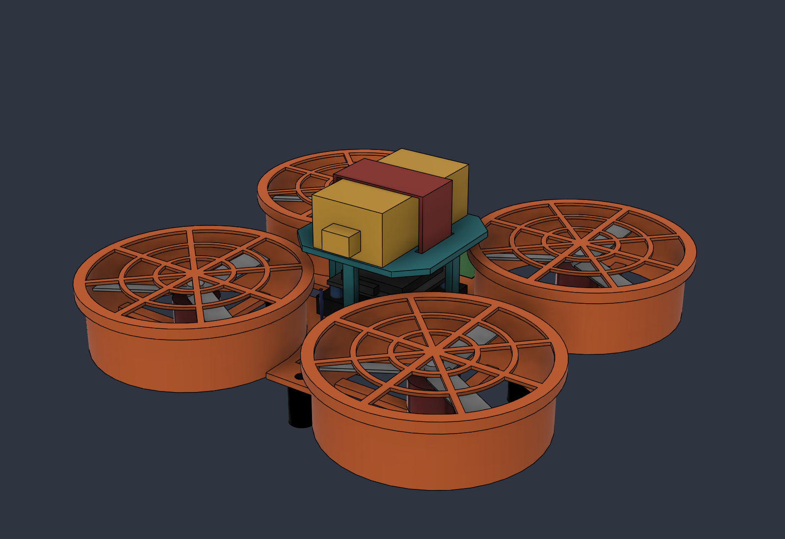

# BYM Kestrel: beginner educational drone kit

> ⚠️ **Version 1 is a design prototype, not a product.** Nothing here has been built, bench-tested or flown. The parts list, parameters and CAD are a starting point for prototyping. **Do not fly with students** until the verification plan in the spec (section 11) has passed.

Kestrel is a 3-inch ducted quadcopter kit designed for **BYM** (about 19 cm across, about 240 g):

- **5th–6th graders** build it with a hex driver, snap-fit parts and plug-in connectors. Students do no soldering.
- **High schoolers** program it later: sensors, autonomy, Python and onboard Lua.
- **Indoor position hold:** optical flow keeps the drone in place when you let go of the sticks.
- **Fly from a website:** Chrome Web Serial → handheld remote (also the radio bridge) → ELRS MAVLink link → ArduPilot.
- **Kid safety:** enclosed props, 3S low-voltage packs, physical arm and kill switches, altitude and distance fence, failsafes that land the drone.

## What's in v1

| Path | Contents |
|---|---|
| [docs/BYM_Kestrel_K1_Design_Spec.md](docs/BYM_Kestrel_K1_Design_Spec.md) | Requirements, architecture, trade study, BOM (3 cost tiers), weight/thrust/endurance, radio bridge + website design, safety, student build guide, test plan, risks and open questions |
| [docs/Educational_Drone_Trade_Study.md](docs/Educational_Drone_Trade_Study.md) | What makes a good educational drone: 11 weighted criteria, 8 platforms scored (CoDrone EDU, Crazyflie, Duckiedrone, LiteWing, Drone Soccer, Tello, Kestrel), sensitivity analysis, Rev B targets |
| [cad/](cad/) | STEP (full assembly + printable parts) and STL (printable parts) |
| [renders/](renders/) | Iso, top, front, bottom, exploded and with-remote views |
| [firmware/kestrel_k1_starter.param](firmware/kestrel_k1_starter.param) | ArduPilot Copter starter parameters. **Untested.** |

The master parametric CAD lives in Autodesk Fusion (project *BYM Drone* → *Kestrel K1*). The STEP files here are exports of it.

### Printable parts (Rev A)
| Part | Material | Mass | Notes |
|---|---|---|---|
| P01 Duct deck | PETG | 72.7 g | Needs a ≥ 200 mm bed; no supports |
| P02 Canopy (snap-fit) | PETG | 11.7 g | Print deck-down |
| P03 Finger guard ×4 | PETG | 4.8 g each | Push-on over the duct lip |
| P04 Bumper foot ×4 | TPU 95A | 1.6 g each | Press-fit |

### Core electronics (Rev A picks)
- ARK FPV flight controller running ArduPilot
- MicoAir MTF-01 optical flow + ToF sensor
- 30.5 mm AM32 4-in-1 ESC
- 4× 1404 4600 KV motors with 3" ducted props
- ESP-based ELRS receiver
- 3S 450 mAh LiPo
- Remote: RadioMaster Pocket + external ESP32 ELRS TX module, USB to laptop

Details, prices and alternatives are in the spec.

## Status and known gaps
- [ ] Order and bench-test one instructor kit (failsafes, flow hold, Web Serial on Windows and ChromeOS)
- [ ] Confirm the ELRS TX module's USB data port (MAVLink bridge)
- [ ] Thrust stand: 1404 4600 KV + 3" duct on 3S
- [ ] Rev B CAD: ≤ 200 g, flow-sensor clip, wire routing, 180 mm-bed variant
- [ ] Web app v0: connect / telemetry / Blockly takeoff-and-land
- [ ] Pilot build with 4 students

**Still open (owner's decisions):** budget per kit, class size, indoor only, printers, volunteer pre-kitting capacity, laptop OS.

## Safety
LiPo batteries and spinning props can hurt people. Adults handle charging. Fly only in a cleared, netted area, with the kill switch tested before every session. See spec section 8.

## License
**Not yet chosen.** Until BYM picks a license, all rights are reserved by the authors. Open-hardware options to consider: CERN-OHL-P / CC BY-SA 4.0 for CAD and docs, MIT / GPLv3 for code.
