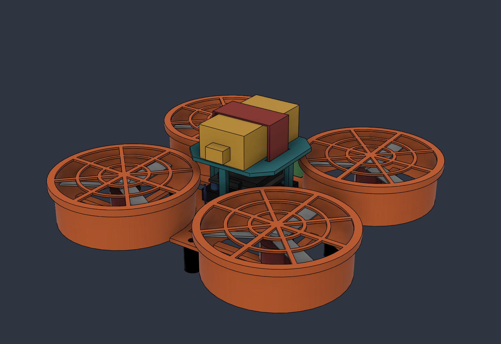

# BYM Kestrel K1: Beginner Drone Kit Design Specification

**Rev A, 2026-11-09.** Concept and preliminary design. Nothing has been bench-tested yet.
**Name:** "Kestrel" is a working name. Kestrels are the birds that hover in place, which is what optical-flow position hold does.
**CAD:** Fusion → project **BYM Drone** → `Kestrel K1/BYM_Kestrel_K1_Assembly`, plus the `Parts - Printable` and `Parts - COTS Placeholders` folders.
**Repo files:** [cad/](../cad/) (STEP/STL), [renders/](../renders/), [kestrel_k1_starter.param](../firmware/kestrel_k1_starter.param).



---

## 0. Summary

The Kestrel K1 is a **3-inch ducted quadcopter (about 19 cm across, about 240 g)** for classrooms. 5th and 6th graders build it with **one hex driver and their fingers**. A snap-fit canopy and plug-in connectors mean there is no soldering for students. It flies **indoors with optical-flow position hold**, so it "parks" in the air when you let go of the sticks.

The same kit grows into a **high-school autonomy platform**. Students fly and program it from a **website in Chrome (Web Serial)**. The website talks MAVLink through the **handheld remote, which doubles as the radio bridge**. The link is ExpressLRS in MAVLink mode: the remote's TX module is plugged into the laptop by USB-C.

| Subsystem | Recommended pick | Why (top criterion: reliability) |
|---|---|---|
| Flight controller | **ARK Electronics ARK FPV** (H743, ArduPilot/PX4) | Pixhawk-class: it is derived from ARKV6X, the same lineage as the mRo full-stack boards you trusted. It has an industrial IMU with a heater, keyed **JST-GH plug-in ports**, and it is US-made, in stock and well documented for both PX4 and ArduPilot. |
| Firmware | **ArduPilot Copter** (latest stable) | Mature optical-flow Loiter, fence, failsafes, Guided-mode API and onboard Lua scripting on H7 boards. Open source; PX4 also runs on the same board. |
| Flow + height sensor | **MicoAir MTF-01** (PMW3901-class flow + 8 m ToF, UART/MAVLink) | One 4.5 g module with an ArduPilot wiki page. It ships with a **GH cable that plugs straight into the FC TELEM port**. It is a different vendor and design from the mRo flow board that gave you trouble. |
| ESC | 4-in-1, 30.5 mm, AM32 firmware (**ARK 4IN1 ESC CONS** with MR30 motor plugs, or the lower-cost Holybro Tekko32 F4 4in1) | Stack form factor, open AM32 firmware, DShot with telemetry. |
| Power | **3S 450–650 mAh LiPo, XT30** | 12.6 V max is low voltage. Pack energy (5–7 Wh) is about the same as a 2S 650–850. See §2 for why 3S beats 2S here. |
| Radio + bridge | **RadioMaster Pocket (EdgeTX)** + **external ESP32 ELRS Nano TX module** (USB-C to laptop); ESP-based ELRS receiver | ELRS ≥3.5 **MAVLink mode** carries sticks and full MAVLink on one link. An external module's USB port shows up as a COM port, which the website opens with Web Serial at 460800 baud. |
| Frame | **Printed PETG one-piece duct deck**, snap-fit canopy, push-on finger guards, TPU feet | 4 snap legs, 16 motor screws and 4 thumb nuts. Prop is fully enclosed above and below. |

**Decisions only you can make (I assumed defaults; see §12):** budget per kit, class size, and indoor-only use. Also printer bed size, volunteer soldering capacity and which laptops the classes use.

---

## 1. Requirements

| ID | Requirement | Source | Verification |
|---|---|---|---|
| R1 | 5th/6th graders assemble the drone in **≤ 90 min** with simple tools; **no student soldering**; plug-in connectors | User | Pilot build with 4 students |
| R2 | Frame is snap-fit or few-screw (≤ 20 screws, one driver size) | User | Count: 16× M2 motor screws (one 1.5 mm hex), 4 nylon thumb nuts |
| R3 | Brushless motors; electronics stay simple (few boxes, keyed plugs) | User | 5 electronic modules, all keyed plugs |
| R4 | **Reliable COTS FC** on an open, documented firmware stack | User (mRo full-stack experience) | Pixhawk-class FC; ArduPilot or PX4 |
| R5 | **Optical-flow position hold** indoors (hover drift < 0.3 m over 30 s on the textured mat) | User | Flight test |
| R6 | Students fly and program from a **website** over a COM port (Web Serial, Chrome/Edge) | User | Web demo: connect → telemetry → takeoff/land |
| R7 | **Handheld remote = controller and radio bridge** (USB to computer, RF to drone) | User | One USB cable, one radio link |
| R8 | Kid safety: ducts and guards, low voltage, arm switch + kill switch, altitude/geofence, failsafes | User | §8 test list |
| R9 | Grows to high school: sensors, programming (JS/Python/Lua), autonomy | User | Curriculum ladder §10 |
| R10 | Open path to custom hardware/firmware later | User | Open firmware, MAVLink, open ESC firmware |
| R11 | AUW **≤ 250 g** (target; matters for any outdoor recreational use) | Engineer | Scale |
| R12 | Flight time **≥ 4 min** per pack; ≥ 3 packs per kit | Engineer | Timer |
| R13 | Printable on a common ≥ 200 mm bed printer in PETG/TPU, no supports | Engineer | Slice and print |
| R14 | Parts in stock from ≥ 2 vendors, or an alternate listed | Engineer | BOM review each term |

---

## 2. Assumptions and conflicts (flagged, not silently decided)

| # | Item | What I assumed / decided | Why it is flagged |
|---|---|---|---|
| A1 | **Indoor only** (gym or classroom with a textured mat) | Indoor | Optical flow needs light and floor texture. Outdoor use adds FAA rules and wind. **Your call.** |
| A2 | **Budget** | Three tiers (§5.3), each drone + remote + 3 packs: about **$715** (ARK FPV + ARK ESC), **$575** (ARK FPV + Tekko32, recommended) and **$485** (Matek value tier) | **Your call.** It drives the FC/ESC choice. |
| A3 | **Class size** | 12–16 students in pairs → **6–8 kits** + 1 instructor kit | **Your call.** It drives charger count and spares. |
| C1 | **"No soldering" vs brushless COTS** | Students never solder. **BYM volunteers pre-terminate each kit once** (about 30–45 min/kit): MR30 plugs on motors, XT30 lead, RX cable. Kits are reused across classes. Buying the ARK 4IN1 ESC **CONS** (factory MR30 sockets) removes all ESC-side soldering. | No brushless COTS stack ships fully plug-in today. Brushed whoops do, but they would fail R4/R5. |
| C2 | **"Low voltage" → I chose 3S, not 2S** | 3S (12.6 V max) | The ARK ESC and most AM32 4-in-1s are rated 3S minimum. Mainstream 3" motors also need ≥ 3S at sane KV. A 3S 450 mAh pack (5.0 Wh) holds the same energy as a 2S 650. **2S is possible** with 6000–7500 KV 1404s (e.g. Emax ECO Micro 1404 6000 KV) and a 2S-rated ESC, but thrust data is thin, so it needs a thrust-stand test. |
| C3 | **mRo boards** | Not used in the kit | The mRo Control Zero H7 is now sold through the 3DR store at **$349.90 with a 3–4 week lead time**. It is great, but too costly per kit. The ARK FPV is the same "Pixhawk-class full stack" idea at about half the price and 7.5 g. Keep an mRo/ARKV6X board as the **instructor reference**. |
| C4 | **Parametric CAD vs separate part files** | One **master parametric assembly** (user parameters drive ducts and heights). **Copies** of each component are saved as separate part files for visibility and printing. | The part files are copies, not linked masters, because Fusion parameters live per document. Linking would break the parameter drive. If you prefer the linked-master pattern used in ENAE 483, say so and it can be converted. |
| C5 | **ELRS MAVLink-mode RC failsafe** | Use it, but **prove failsafe on the bench first** (§8) | Forum reports disagree on how RC override loss maps to ArduPilot RC failsafe. Fallback options are in §7.5. |
| C6 | **Kakute H7 Mini** | Rejected | It was the obvious 20×20 ArduPilot board, but ArduPilot's wiki notes **v1.5 unavailable since mid-2025**. That is a supply-reliability fail. |

---

## 3. System architecture

```
                         ┌──────────────────────────── Laptop / Chromebook ────────────────────────────┐
                         │  Chrome/Edge → BYM Flight Web App (static site, offline-capable PWA)          │
                         │   • Web Serial: COMx @ 460800 8N1, DTR low (Windows)                          │
                         │   • MAVLink v2 encoder/decoder (JS)  • Blockly (MS) / JS & Python (HS) editors │
                         │   • Telemetry dashboard: attitude, height, flow quality, battery, mode, fence │
                         └───────────────────────────────▲─────────────────────────────────────────────┘
                                                         │ USB-C (MAVLink over USB CDC serial)
┌──────────── Handheld remote = controller + radio bridge ┴────────────────┐
│ RadioMaster Pocket (EdgeTX): 2 sticks, ARM switch, KILL switch (guarded),│
│ MODE switch [LOITER | COMPUTER(GUIDED) | LAND]                           │
│        │ CRSF (sticks/switches)                                          │
│ External ESP32 ELRS Nano TX module ── MAVLink mode (ELRS ≥ 3.5) ─────────┼──► 2.4 GHz ELRS link
└──────────────────────────────────────────────────────────────────────────┘    sticks + full MAVLink both ways
                                                                                       │
┌──────────────────────────────── Kestrel K1 drone ────────────────────────────────────▼────────────┐
│ ELRS RX (ESP8285, MAVLink mode) ──JST-GH 4p──► ARK FPV  RC port (USART6, SERIALx_PROTOCOL=2)       │
│ MicoAir MTF-01 (flow + ToF)     ──JST-GH 6p──► ARK FPV  TELEM port (UART7, MAVLink1 115200)        │
│ 4-in-1 ESC (AM32/ARK32)         ──8-pin──────► ARK FPV  PWM/ESC port (DShot600 + bidir + ESC tlm)  │
│ 3S LiPo ── XT30 ──► ESC power ─(VBAT, current)─► FC     4× 1404 4600KV ◄─MR30─ ESC                 │
│ ArduPilot Copter: EKF3 (IMU + baro + flow + ToF), LOITER/GUIDED/LAND, fence, failsafes, Lua (HS)  │
└───────────────────────────────────────────────────────────────────────────────────────────────────┘
```

**Who wins when inputs disagree:** the handset is always the master.
1. The **KILL** switch stops the motors immediately, in any mode.
2. The **MODE** switch decides whether the website may fly the drone. Only the COMPUTER (GUIDED) position accepts web commands. In LOITER or LAND, ArduPilot ignores position targets.
3. Flipping MODE to LOITER makes the drone hover where it is. This is the "take back control" gesture students learn on day one.

---

## 4. Component selection (trade study)

### 4.1 Flight controller

| Option | Price | Plug-in? | Reliability notes | Verdict |
|---|---|---|---|---|
| **ARK FPV** (ARK Electronics) | **$194.99**, in stock | **Yes, JST-GH** RC/TELEM/GPS/CAN; 8-pin ESC port | Derived from ARKV6X (Pixhawk FMUv6X class); industrial IIM-42653 IMU with heater; BMP390 baro; 2S–12S input; PX4 default, ArduPilot and Betaflight supported; US-built | **Recommended** |
| Matek H743-Mini V3 (20×20) | ≈ $96–144, spotty stock | ESC plug only; UARTs are pads | Matek H7 boards have a strong ArduPilot track record | **Value tier**: volunteers solder GH pigtails once |
| mRo / 3DR Control Zero H7 OEM | $349.90, 3–4 wk lead | JST-GH | Your proven "full stack" lineage | Instructor/reference board |
| Holybro Kakute H7 Mini v1.5 | n/a | ESC plug only | ArduPilot wiki: unavailable since mid-2025 | Rejected (supply) |
| Crazyflie 2.1 Brushless + Flow deck + Crazyradio | Very high (AI bundle $780; drone alone listed around $714 at one reseller) | Pre-built PCB frame | Excellent research platform, but students build little and it is costly | Rejected for kits; good HS elective |
| Betaflight / INAV AIO whoop boards | $30–60 | Mostly | No real flow position hold (Betaflight); weak Guided API; AIO boards were your bad experience | Rejected |

### 4.2 Optical flow and height
| Option | Interface | Notes | Verdict |
|---|---|---|---|
| **MicoAir MTF-01** | UART (MAVLink "mav-apm" or MSP) | Flow + 8 m ToF, 4.5 g, $22.90 (MicoAir) / $32.99 (Pyrodrone); ArduPilot wiki setup page; ships with an SH→GH 6-pin Pixhawk cable | **Recommended** |
| MicoAir MTF-01P | UART | 12 m range, about $42 | Upgrade if the gym is tall |
| Holybro H-Flow / ARK Flow | **DroneCAN** | Newer PAA3905 flow sensors + Broadcom ToF; CAN is the most robust bus, and the ARK FPV has a CAN port | **HS / Rev B upgrade path** |
| Matek 3901-L0X | MSP | Cheap; ToF only about 2 m; light sensitive | Fallback only |

### 4.3 Radio link and bridge
| Option | Bridge to website | Notes | Verdict |
|---|---|---|---|
| **ELRS MAVLink mode** (TX + RX ≥ 3.5, ESP-based) | **External TX module USB** → COM port | One link carries sticks and MAVLink; officially documented; 460800 baud; Windows needs DTR low; internal modules have **no** USB path (Wi-Fi backpack only, which browsers can't use) | **Recommended** |
| mLRS | TX module serial/USB | Purpose-built MAVLink link with strong RC failsafe semantics; smaller hardware selection | Fallback A |
| ELRS CRSF (RC) + separate telemetry radio | Telemetry radio USB | Most proven RC failsafe, but 2 radios on the drone and 2 USB devices | Fallback B |
| ESP-NOW custom remote | Custom firmware | Cheap and fun, but it is custom firmware | Later "BYM custom hardware" phase |

---

## 5. Bill of materials

Prices are USD, approximate, checked 2026-11-09 where a source is given. **"est."** means not verified this session.

### 5.1 Per drone, recommended "reliability-first" tier
| # | Item | Specific part | Qty | Unit $ | Ext $ | Alternatives |
|---|---|---|---|---|---|---|
| 1 | Flight controller | **ARK FPV Flight Controller** | 1 | 194.99 | 194.99 | Matek H743-Mini V3 (value tier); mRo/3DR Control Zero H7 |
| 2 | 4-in-1 ESC | **ARK 4IN1 ESC CONS** (3–8S, MR30 motor sockets, ARK32/AM32) | 1 | est. 150–250 | 200 | **Holybro Tekko32 F4 4in1 50A AM32 30×30** (est. $60–70; needs MR30 pigtails + SH→GH 8-pin adapter, pin map to verify) |
| 3 | Motors | iFlight XING2 1404 **4600 KV** (3S) | 4 | est. 16 | 64 | T-Motor F1404 4600 KV; RCinpower Smoox 1404 Plus 5000 KV (2–3S) |
| 4 | Props | Gemfan D76 3" ducted (3- or 5-blade), shaft type to match motor | 3 sets | est. 4 | 12 | HQProp DT76 |
| 5 | Flow + ToF | **MicoAir MTF-01** | 1 | 22.90–32.99 | 30 | MTF-01P; Holybro H-Flow (CAN) |
| 6 | Receiver | ESP-based ELRS 2.4 GHz RX, e.g. RadioMaster RP2/RP1 V2 or BetaFPV ELRS Lite | 1 | est. 15–20 | 18 | Any **ESP8285/ESP32** ELRS RX (STM32 receivers cannot do MAVLink mode) |
| 7 | Battery | 3S **450 mAh** 75C XT30 (e.g. Tattu R-Line / GNB) | 3 | est. 15 | 45 | 3S 650 mAh (longer flight, but AUW goes over 250 g) |
| 8 | Connectors | MR30 pairs (if not CONS ESC), XT30 pigtail | 1 set | est. 10 | 10 | |
| 9 | Cables | JST-GH 4-pin (RX), GH 8-pin ESC lead (if not ARK ESC) | 1 set | est. 6 | 6 | |
| 10 | Hardware | M3×20 nylon standoffs + thumb nuts ×4, soft-mount grommets, M2×5 screws ×16, battery strap | 1 | est. 6 | 6 | |
| 11 | Printed parts | PETG about 108 g + TPU about 6 g (§9) | 1 | about 3 | 3 | |
| | **Drone subtotal** | | | | **≈ $589** | Value tier (Matek H743-Mini + Tekko32): **≈ $360** |

### 5.2 Per remote (one per drone recommended)
| Item | Part | $ |
|---|---|---|
| Handset | **RadioMaster Pocket** (EdgeTX; ELRS or CC2500 version) | 65–78 |
| Bridge TX module | **ESP32 ELRS Nano TX module with USB-C data port**, e.g. RadioMaster Ranger Nano ($39.99) | 40 |
| Cells + cable | 2× 18650 cells, USB-C data cable (1 m) | est. 15 |
| **Remote subtotal** | | **≈ $125** |

> ⚠️ **Verify before buying 8 of them:** RadioMaster's Ranger Nano page does not state that its USB-C port carries data to a PC. ELRS docs require **an external module with USB** for the wired MAVLink path. Buy **one** Ranger Nano, plus one module known to expose USB serial (e.g. RadioMaster **Ranger Micro** or **Nomad** in a Boxer/JR-bay handset), and test both on day 1. If the Nano has no data USB, switch the remote to **RadioMaster Boxer + Ranger Micro**, at about +$60/remote.

### 5.3 Per classroom, shared
| Item | Qty (8 kits) | $ |
|---|---|---|
| Balance charger, 4-port (e.g. ToolkitRC M6/ISDT class) | 2 | est. 120 |
| LiPo safe bags + metal ammo can | 2 + 1 | est. 40 |
| Textured flight mat / high-contrast floor tiles (flow sensor texture) | 1 area about 4×4 m | est. 80 |
| Spare props, motors (2), MTF-01 (1), RX (1), printed part spares | — | est. 150 |
| Instructor kit (same as student) | 1 | ≈ 700 |
| Optional: flying-area netting or pop-up cage | 1 | est. 100–300 |

**Kit totals:** drone + remote + 3 packs ≈ **$715 (reliability tier, ARK ESC)**, **≈ $575 (ARK FPV + Tekko32)**, **≈ $485 (value tier)**. That is before shared classroom gear. My recommendation is **ARK FPV + Tekko32**: it keeps the FC reliability you asked for, and volunteers solder MR30s once.

---

## 6. Weight, thrust and endurance

Printed part masses come from the Fusion CAD (PETG 1.27 g/cm³, TPU 1.21 g/cm³, 100% solid walls).

| Item | g |
|---|---|
| Frame / duct deck (P01) | 72.7 |
| Canopy (P02) | 11.7 |
| Finger guards ×4 (P03) | 19.2 |
| TPU feet ×4 (P04) | 6.4 |
| Motors 1404 ×4 | 38 |
| Props ×4 | 7 |
| ARK FPV | 7.5 |
| 4-in-1 ESC | 13 |
| MTF-01 | 4.5 |
| ELRS RX | 1.5 |
| Standoffs, screws, wires, MR30, XT30, strap | 17 |
| **Dry mass** | **198.5** |
| + 3S 450 mAh | **AUW ≈ 238 g** ✅ < 250 g |
| + 3S 650 mAh | AUW ≈ 254 g (fine indoors) |

**Thrust:** a 1404 4600 KV on 3S (about 10.5 V under load, about 36 k rpm) with a 3" ducted prop gives roughly **210–235 g per motor**. This is a momentum/Ct estimate with about 15% duct augmentation.
- **T/W ≈ 3.4–3.6.** Hover is near half throttle: lively enough for wind-free indoor control, gentle enough for beginners. ArduPilot speed and angle limits (§8) tame it further.

**Hover power and endurance** use momentum theory, disk area 4×π(38.1 mm)², with a figure of merit 0.38–0.55 and motor+ESC efficiency 0.65–0.75. 80% of the pack is used, plus 1.5 W for avionics.

| Pack | AUW | Ideal hover power | Flight time (pess / **nominal** / opt) |
|---|---|---|---|
| 3S 450 mAh | 238 g | 16.9 W | 3.4 / **4.3** / 5.6 min |
| 3S 650 mAh | 254 g | 18.6 W | 4.5 / **5.7** / 7.5 min |

**Battery choice: 3S 450 mAh 75C XT30, 3 packs per kit.** Reasons: about 4–5 min of hover is a natural classroom turn length; the pack keeps AUW under 250 g; and 5 Wh limits fire energy. Use 650 mAh packs for the high-school autonomy labs, which need longer flights.

**Rev B mass target is ≤ 200 g.** Ideas: lightening pockets in the deck, guard grille only on the top half, duct height 22 mm (check prop plane), and a 2.0 mm deck with ribs.

---

## 7. Radio/remote bridge and website

### 7.1 Link setup (ELRS ≥ 3.5 on TX and RX, TX backpack ≥ 1.5)
- ELRS Lua → **Link Mode = MAVLink**. This forces Hybrid/16ch-2 switch mode and a 1:2 telemetry ratio. The RX serial protocol is set to MAVLink (automatic in v4, manual in v3.5).
- Use 2.4 GHz hardware; 900 MHz is too slow for MAVLink.
- RX → ARK FPV **RC port (USART6)**: `SERIAL6_PROTOCOL=2`, `SERIAL6_BAUD=460`, `RSSI_TYPE=5`, `SR6_*`/`MAVx_*` stream rates = 1 except ADSB/PARAMS/RAW_CTRL = 0.
- Keep `SYSID_THISMAV=1`. There is a reported ELRS issue where RC stops working if the vehicle sysid is not 1. Each drone gets its own **ELRS binding phrase**, so kits never cross-talk; the sysid stays 1.

### 7.2 Website ↔ remote
- **Transport:** `navigator.serial.requestPort()`; open the port at **460800 baud, 8N1**. Call `port.setSignals({ dataTerminalReady: false })`, since ELRS docs say Windows needs DTR low or the module may reboot or lock. Works in **Chrome/Edge on Windows, macOS, Linux and ChromeOS**. Safari and Firefox do not support Web Serial.
- **Protocol:** MAVLink v2. The JS codec is generated with `mavgen` (TypeScript target) for the `ardupilotmega` dialect and bundled into the static site. The site sends a GCS `HEARTBEAT` at 1 Hz with sysid 255.
- **On connect:** the site sends `SET_GPS_GLOBAL_ORIGIN` and `MAV_CMD_DO_SET_HOME` with a fixed fake lat/lon (school coordinates). This gives EKF3 an origin, so **GUIDED works without GPS**.
- **Read:** `ATTITUDE`, `LOCAL_POSITION_NED`, `DISTANCE_SENSOR`, `OPTICAL_FLOW`, `BATTERY_STATUS`/`SYS_STATUS`, `HEARTBEAT` (mode/armed), `STATUSTEXT`, `RC_CHANNELS` (shows which switch is where).
- **Write, only in GUIDED (handset MODE = COMPUTER):**
  - `MAV_CMD_NAV_TAKEOFF` (alt ≤ 1.5 m)
  - `SET_POSITION_TARGET_LOCAL_NED` with `MAV_FRAME_BODY_OFFSET_NED` ("forward 0.5 m", "turn 90°")
  - `MAV_CMD_NAV_LAND`
- **Web never arms by default.** Arming is a physical switch. An instructor-only setting can allow web arming for HS labs.
- **On-screen STOP button:** sends `MAV_CMD_NAV_LAND`. The handset KILL switch remains the real emergency stop.

### 7.3 Student programming layers
| Level | Interface | Example |
|---|---|---|
| Grade 5–6 | **Blockly** blocks → MAVLink commands | "take off 1 m → forward 50 cm → spin 360° → land" |
| Grade 7–9 | JavaScript in the browser (sandboxed API: `drone.takeoff(1)`, `drone.move(0.5,0,0)`, `drone.onHeight(cb)`) | Square path; "stop if height < 0.4 m" |
| High school | **Python** (pymavlink/MAVSDK) on the same COM port; **Lua scripts onboard** (H7); log analysis | Sensor fusion lab, PID tuning concepts, autonomous patterns |

### 7.4 Lab mode without a handset (optional)
ELRS docs: a TX module in **standalone mode** starts the RF link when it sees MAVLink on USB. A website plus a $20 USB gamepad (Gamepad API → `MANUAL_CONTROL`) could then fly the drone. This is cheaper, but the **physical KILL switch is lost**, so it is **not for middle school**.

### 7.5 Fallbacks if the C5 failsafe test fails
1. Configure the ELRS RX failsafe so the FC loses `RC_CHANNELS_OVERRIDE`, and set `RC_OVERRIDE_TIME` short (e.g. 0.5 s) with `FS_THR_ENABLE=3` (Land).
2. Switch the link to **mLRS**.
3. Two-radio split: CRSF for RC plus a USB telemetry radio for MAVLink.

---

## 8. Safety design

| Hazard | Control |
|---|---|
| Fingers in props | Props fully enclosed: duct + bottom spokes + **snap-on top finger guard** (grille gaps ≤ 13 mm; check with the "finger probe" test). Props spin only when armed. |
| Unexpected spin-up | Arming needs: physical **ARM switch** + throttle low + pre-arm checks (`ARMING_CHECK=1`). `MOT_SPIN_ARM` low idle gives a visible "armed" cue. Web arming is disabled by default. |
| Runaway / bad command | **KILL switch** (`RCx_OPTION=31`, Motor Emergency Stop) on a guarded handset switch. MODE switch to LOITER takes control back from the website. |
| Flying too high or far | **Fence:** `FENCE_ENABLE=1`, `FENCE_TYPE=3` (max alt + circle), `FENCE_ALT_MAX=2.0` m, `FENCE_RADIUS=3` m, `FENCE_ACTION=2` (Land). Also `PILOT_SPEED_UP=50`, `LOIT_SPEED=100`, `ANGLE_MAX=1500` (15°). |
| Link loss | `FS_THR_ENABLE=3` (Land); GCS failsafe `FS_GCS_ENABLE=5` (Land) in GUIDED when the website disconnects. Bench-test per C5. |
| Low battery | `BATT_LOW_VOLT=10.5`, `BATT_CRT_VOLT=10.0`, `BATT_FS_LOW_ACT=1` (Land), `BATT_FS_CRT_ACT=1` (Land). |
| Flow loss (dark or shiny floor) | EKF failsafe → Land (`FS_EKF_ACTION=1`); textured mat; lights on. |
| LiPo fire | 3S **450 mAh** packs (5 Wh); **adult-only charging** in LiPo bags; storage voltage after class; damaged packs retired; ammo can for storage. |
| Low voltage | 12.6 V max (SELV, no shock hazard); XT30 polarized; connectors keyed. |
| Flying area | Pilots behind a line ≥ 2 m from the mat edge; netting recommended; safety glasses for build and flight days. |

The starter parameter file is at [kestrel_k1_starter.param](../firmware/kestrel_k1_starter.param). It is **untested** and must be bench-verified with props off.

---

## 9. Mechanical design (Fusion CAD)

**Where:** Fusion → **BYM Drone** project (new; ENAE 483 untouched):
- `Kestrel K1/BYM_Kestrel_K1_Assembly`: master, Z-up, user parameters.
- `Kestrel K1/Parts - Printable/`: `K1_P01_Frame_DuctDeck`, `K1_P02_Canopy_TopDeck`, `K1_P03_FingerGuard`, `K1_P04_BumperFoot_TPU`.
- `Kestrel K1/Parts - COTS Placeholders/`: `K1_C01_Motor_1404_4600KV` … `K1_C11_USB_C_Cable_to_Laptop`. These are simplified envelopes, dimensions approximate.

**Exports:** [cad/K1_Assembly.step](../cad/K1_Assembly.step), plus a STEP and STL for each printable part in [cad/](../cad/).
**Renders:** [iso](../renders/01_iso_hero.png), [top](../renders/02_top.png), [front](../renders/03_front.png), [bottom/flow sensor](../renders/04_bottom_flow_sensor.png), [with remote](../renders/05_with_remote_bridge.png), [exploded](../renders/06_exploded.png).

| Part | Material | Mass | Envelope (mm) | Print notes |
|---|---|---|---|---|
| P01 Duct deck (4 ducts, motor spokes, stack holes 30.5 + 20×20, flow window, snap slots) | PETG | 72.7 g | 192.5 × 192.5 × 26 | Flat on bed as modeled, no supports; 3 walls, 0.2 mm layers; **needs a ≥ 200 mm bed** |
| P02 Canopy/top deck with 4 snap legs, battery-strap slots, FRONT arrow | PETG | 11.7 g | 60 × 60 × 40 | Print upside-down (deck on bed), legs up |
| P03 Finger guard (×4), push-on skirt over the duct lip | PETG | 4.8 g | 88.8 × 88.8 × 4.3 | Grille on bed, no supports |
| P04 Bumper foot (×4), press-fit peg | TPU 95A | 1.6 g | Ø10 × 18.5 | 100% infill |

**Key user parameters:** `prop_d` 76.2, `duct_clear` 1.9 → `duct_id` 80, `duct_wall` 1.2, `duct_h` 26, `plate_t` 2.5, `lip_w` 2, `lip_t` 1.6, `pad_d` 18, `guard_t` 1.2, `m2_d`/`m3_d`, `canopy_z` 36, `foot_h` 16 (mm).
- These drive the duct/prop diameters, all heights and thicknesses and the hole sizes directly. Changing them was tested: duct height, wall and plate thickness re-solve cleanly.
- `wheelbase` (150) and `bar_w` are **build-time only**. Bars and duct positions are fixed sketch geometry. Moving them needs a re-sketch; this is a Rev B task.

**Design features for kids:**
- The FRONT arrow is cut through the canopy.
- The orange ducts are visible and read as "don't touch".
- Snap legs click audibly.
- The flow sensor sits in a nose window you can see ("the drone's eye").

**Known CAD gaps (Rev B):**
- MTF-01 retention clip.
- Wire channels and zip-tie points.
- Exact FC/ESC models with connector positions.
- Fillets on the deck/duct junction (crash strength).
- 180 mm-bed variant (e.g. Bambu A1 mini).
- Linked-master part files (C4).

---

## 10. Build guide for students (6th-grade reading level)

**Before class (volunteers, once per kit):**
1. Flash ArduPilot, load the params, calibrate, set motor order and direction (props off).
2. Bind ELRS. Set the flow sensor to `mav-apm`.
3. Fit MR30 and XT30 plugs and the RX cable.
4. Test-hover. Then take the drone apart into a labeled kit bag.

**Tools for students:** a **1.5 mm hex screwdriver** (one per pair), safety glasses, and the parts tray. Nothing else, and no soldering.

> **Team jobs:** *Builder* holds the driver. *Checker* reads the step out loud and checks it off. Swap jobs every 3 steps.

| Step | What you do | Check it! |
|---|---|---|
| 1 | **Meet your drone.** Lay out the orange frame, teal roof, 4 guards, 4 black feet, 4 motors and the electronics bag. Find the **FRONT arrow** on the roof. | Everything matches the picture card. |
| 2 | **Feet on.** Push the 4 black rubber feet into the 4 small holes under the frame until they click flat. | The frame sits flat and doesn't wobble. |
| 3 | **Motors in.** Put a motor on each round motor pad, wires pointing toward the middle. Screw in 4 tiny screws per motor with the hex driver. **Snug, not super tight!** | The motor doesn't wiggle. 16 screws total. |
| 4 | **Stack in.** Put the 4 rubber bumpers on the 4 tall posts in the middle. Slide the **black ESC board** on, arrow pointing FRONT. Slide the **flight controller (the brain)** on top. Spin on the 4 plastic thumb nuts by hand. | Both arrows point to FRONT. |
| 5 | **Plug in the motors.** Each motor has a plug. Push it into the matching numbered socket (1–4) on the ESC. Plugs only fit one way, so don't force them! | Four plugs, numbers match. |
| 6 | **Connect the brain.** Plug the short flat cable from the ESC into the FC socket marked "ESC". | Click! |
| 7 | **Install the eye.** Drop the green flow sensor into the nose window, lens facing **down**. Plug its cable into the FC socket marked **TELEM**. | Look underneath: you can see the lens. |
| 8 | **Install the radio.** Stick the small blue receiver on the back of the frame with the sticky pad. Plug its cable into the FC socket marked **RC**. Clip the antenna into the roof clip. | The antenna points up and does not touch a prop. |
| 9 | **Roof on.** Line up the 4 legs of the teal roof with the 4 slots and push down until you hear **4 clicks**. | Gently lift the roof: it stays on. |
| 10 | **Props on (adult check first!).** Each prop has a letter (A or B) that matches the motor sticker. Press it onto the motor until it's flat. | Teacher checks the props. |
| 11 | **Guards on.** Push an orange guard onto the top of each duct until it sits flat all around. | Fingers can't reach any prop. |
| 12 | **Battery and strap.** Slide the battery onto the roof and wrap the red strap around it. **Don't plug it in yet.** | The battery doesn't slide. |
| 13 | **Pre-flight check with the teacher:** handset ON, **KILL = ON (safe)**, ARM = OFF. Then plug in the battery and wait for the beeps. | Website shows "Connected, Disarmed, Battery OK". |

**About 60–75 min for a pair.** Teardown is the reverse: guards → props → battery → roof (squeeze the legs) → plugs.

---

## 11. Verification plan (before the first class)

1. **Bench, props off:**
   - Motor order and direction.
   - KILL switch stops the motors instantly in every mode.
   - ARM blocked when throttle is up or the KILL switch is on.
2. **Failsafes:**
   - Turn the handset off → drone lands. Measure time-to-land.
   - Unplug USB while the website is in GUIDED → drone lands.
   - Low-battery land.
   - Fence breach (set a 1 m alt fence) → drone lands.
3. **Flow hold:** 30 s hover over the mat and over plain gym floor; log drift. Repeat under dim lights.
4. **Web Serial:** Windows (DTR low), ChromeOS, macOS; check sustained telemetry at 460800.
5. **Mechanical:** 1 m drop test onto the gym floor, 10× per frame (PETG at 3 walls); count snap-leg cycles until whitening; finger-probe test on guards.
6. **Thrust stand:** 1404 4600 KV + D76 at 3S; confirm ≥ 200 g/motor and hover current.
7. **Pilot build:** 4 students (5th/6th grade) and a timer. Note every place they got stuck.

---

## 12. Risks and open questions

| # | Risk / question | Impact | Mitigation / owner |
|---|---|---|---|
| Q1 | **Budget per kit?** (§5 tiers: $485 / $575 / $715) | Picks the FC/ESC tier | **User** |
| Q2 | **Class size and teams?** | Kit count, chargers, spares | **User** |
| Q3 | **Indoor only?** Gym size, floor type, lighting | Flow performance; outdoor → FAA TRUST, wind, 250 g limit | **User** |
| Q4 | Which printers (bed ≥ 200 mm)? PETG available? | P01 doesn't fit 180 mm beds | User → Rev B variant |
| Q5 | Volunteer soldering capacity for pre-kitting? | Or pay for the ARK CONS ESC (+ about $140/kit) | User |
| Q6 | Laptops: Windows / ChromeOS / Mac? Is Chrome allowed? | Web Serial needs Chrome/Edge | User |
| R1 | ELRS MAVLink-mode RC failsafe semantics | Safety-critical | Bench test (§11), fallbacks §7.5 |
| R2 | Ranger Nano USB data port unconfirmed | Bridge may need a different module or handset | Buy 1 first; Boxer + Ranger Micro fallback |
| R3 | ARK 4IN1 ESC CONS price/stock not confirmed | Tier cost | Tekko32 alternative |
| R4 | Optical flow on shiny or plain floors | Drift, land failsafe | Textured mat; MTF-01P or H-Flow upgrade |
| R5 | AUW 238–254 g; T/W ≈ 3.4 (estimate) | Flight time 4–6 min | Rev B lightening; thrust test |
| R6 | 1404 shaft/prop fit (1.5 mm vs T-mount) varies by motor | Props may not fit | Order motor + prop samples together |
| R7 | SH↔GH 8-pin ESC adapter pinout (non-ARK ESC) | Wrong pinout can damage the ESC or FC | Make and verify one adapter, then crimp a batch |
| R8 | ArduPilot 4.7 renamed some MAVLink options (`MAVx_OPTIONS`) | Param file drift | Pin the firmware version per term |
| R9 | Snap-leg fatigue across many classes | Loose roof | Spare canopies (11.7 g each, cheap) |
| R10 | Part availability (FPV parts churn fast) | Kit build delays | Two vendors per part; re-check the BOM each term |

---

## 13. Roadmap

- **Rev A (this):**
  - Concept, BOM, CAD, param starter.
  - **Next:** order 1 instructor kit plus both candidate TX modules → bench tests §11.
- **Rev B:**
  - Mass ≤ 200 g, sensor clip, linked part files, 180 mm-bed variant.
  - First version of the web app (connect / telemetry / Blockly takeoff-land).
- **Rev C (BYM custom):**
  - A BYM remote PCB (ESP32-S3: sticks, kill switch, native USB CDC, ELRS module socket).
  - Then, if wanted, a BYM FC carrier around a Pixhawk-standard core.

---

## Sources
- ExpressLRS MAVLink docs: https://www.expresslrs.org/software/mavlink/
- ELRS + ArduPilot MAVLink guide (Nomad/DBR4): https://www.unmannedtechshop.co.uk/blogs/knowledge-base/elrs-mavlink-ardupilot-nomad-dbr4-setup
- ArduPilot MAVLink RC input (`RC_OVERRIDE_TIME`, `SYSID_MYGCS`): https://ardupilot.org/dev/docs/mavlink-rcinput.html
- ArduPilot forum, failsafe with ELRS MAVLink: https://discuss.ardupilot.org/t/failsafe-settings-with-elrs-mavlink-and-rcin/143149
- ARK FPV, ArduPilot page: https://ardupilot.org/copter/docs/common-ark-fpv.html; PX4 page: https://docs.px4.io/main/en/flight_controller/ark_fpv.html; store: https://arkelectron.com/product/ark-fpv-flight-controller/
- ARK 4IN1 ESC: https://docs.arkelectron.com/electronic-speed-controller/ark-4in1-esc; https://ardupilot.org/copter/docs/common-ark-4in1-esc_con.html
- MTF-01 ArduPilot setup: https://ardupilot.org/copter/docs/common-mtf-01.html; price: https://store.micoair.com/?p=2905, https://pyrodrone.com/collections/all-products/products/micoair-mtf-01-optical-flow-8m-range-2in1-sensor
- Kakute H7 Mini availability note: https://ardupilot.org/rover/docs/common-holybro-kakuteh7mini.html
- Matek H743-Mini V3 listings: https://www.racedayquads.com/products/matek-h743-mini-v3-20x20-flight-controller
- mRo/3DR Control Zero H7 OEM: https://store.3dr.com/control-zero-h7-oem/
- Crazyflie 2.1 Brushless bundle: https://store.bitcraze.io/collections/bundles-crazyflie-2-1-brushless/products/the-ai-bundle-crazyflie-2-1-brushless
- RadioMaster Ranger Nano: https://radiomasterrc.com/collections/popular-products/products/ranger-nano-2-4ghz-elrs-module; Pocket: https://store.flitetest.com/radiomaster-pocket-elrs/
- 1404 motor options (XING X1404 KV range, Emax ECO Micro 1404): https://racer.lt/lt/catalog/item/iflight-xing-x1404-1404-3800kv-4600kv-7000kv-2-4s-brushless-motor-for-toothpick-rc-drone-fpv-racing-24215.html, https://speedyfpv.com/products/emax-eco-micro-1404-brushless-motor-2-4s-3700-4800-6000kv
